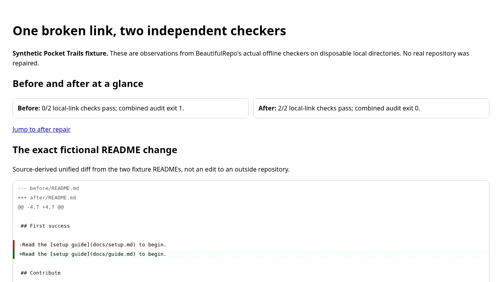
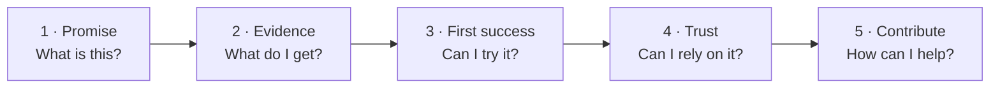

<div align="center">
  <h1>✨ BeautifulRepo</h1>
  <p><strong>Catch concrete README and local-documentation problems before a new contributor does.</strong></p>
  <p>Dependency-free offline checks, reproducible examples and practical templates for repositories worth exploring.</p>
</div>

<p align="center">
  <a href="https://github.com/drevendev/BeautifulRepo/actions/workflows/quality.yml"></a>
  <a href="LICENSE"></a>
  <a href="tools/README.md"></a>
  <a href="tools/README.md"></a>
</p>

<p align="center">
  <a href="SHOWCASE.md">See the before/after</a> ·
  <a href="#working-proof">Run an audit</a> ·
  <a href="guides/adopting-the-checks.md#add-it-to-a-workflow">Run checks on PRs</a> ·
  <a href="#start-here">Start here</a> ·
  <a href="examples/README.md">Working examples</a> ·
  <a href="CONTRIBUTING.md">Contribute</a>
</p>

---

> [!TIP]
> **Beautiful is not “more decoration.”** A strong repository reduces the time from landing on the page to understanding the result, trying it, trusting it, and knowing how to contribute.

## Start here

Choose the result you need:

- **Diagnose an existing repository:** run the [offline audit](guides/repository-audit.md) with the [repository checklist](checklists/repository.md) to get specific findings, not a beauty score.
- **Start a new repository:** adapt the [README scaffold](templates/README.template.md) using the [first-success checklist](checklists/first-success.md) to provide a reproducible command and honest scope.
- **Borrow a working example:** explore [five working starter types plus a terminal game](examples/README.md) for runnable source, tests and documented limitations.

## Working proof

The [Pocket Trails showcase](SHOWCASE.md) demonstrates the **actual offline
checkers** finding a broken local link in an explicitly **fictional** repository.
The [browser recording and captioned still](showcase/pocket-trails/README.md)
show a captured synthetic report, not a real-user or accessibility test.

[](SHOWCASE.md)

**Audit your own checkout.** From a directory containing your existing
`your-repository/` folder, clone BeautifulRepo **beside** it. You need Git and
Python 3.11+; only cloning uses the network:

```bash
git clone https://github.com/drevendev/BeautifulRepo.git
cd BeautifulRepo
git checkout --detach e494a0d5be90dd718db4a25e777aba8abc295ecf
python -I tools/audit_bundle.py ../your-repository --fail-on never
```

This immutable `master` commit is a reviewed **development** audit checkout,
not the older `v0.2.0` Action. Its [Quality CI run](https://github.com/drevendev/BeautifulRepo/actions/runs/45364559651)
completed all six jobs successfully on this exact SHA. It includes hard-link and redirected-path source protections, plus readable
text diagnostics in legacy console encodings. CI does not establish a fresh
external-user installation. The audit does not run target code, follow external links or
write the target. Exit **0** means no threshold-reaching findings; **1**
includes broken local destinations even with `--fail-on never`; **2** means
invalid input or incomplete evidence. A clean run does not prove a good README.

**Go deeper:** [complete output and reproduction notes](guides/working-proof.md)
include Windows PowerShell instructions, the real revision-pinned
[PatchPitch case](case-studies/patchpitch.md), synthetic demos and an optional
Chromium capture. To check every PR, use the separate
[SHA-pinned v0.2.0 Action recipe](guides/adopting-the-checks.md#add-it-to-a-workflow);
that pin does **not** include this combined CLI.

## The visitor journey

A repository should answer the next question before the reader has to hunt for it.



**Text alternative:** Promise (what is this?) → Evidence (what do I get?) →
First success (can I try it?) → Trust (can I rely on it?) →
Contribute (how can I help?). Follow the stages in that order.

That sequence is the core BeautifulRepo test. Decoration is optional; a clear path is not.

## What you get

- **📋 Checklists** — prioritize clarity, onboarding, trust, accessibility and maintenance.
- **🧱 Patterns** — source-backed examples of what strong repositories do and why it works.
- **🧰 Templates** — a [task-first chooser](templates/README.md) for README, documentation, maintenance and contributor scaffolds.
- **🔎 Tools** — small dependency-free checks that keep repository documentation honest.
- **🖼️ Visual guidance** — theme-aware media, useful alt text and evidence-first screenshots.
- **🧭 Community guidance** — contribution and reporting surfaces that do not invent unsupported promises.

## See the difference

The [PocketDiff before/after page](examples/readme-visuals/README.md) is an
**explicitly fictional** copy and visual-layout exercise. It contrasts vague
superlatives and decorative badges with a concrete (illustrative) CSV report,
a text alternative and a command transcript. **PocketDiff is not an installable
or tested CLI.**

The [design-intent brief](examples/readme-visuals/DESIGN_INTENT.md) explains
why the light/dark illustrations fit that imagined reader, what was rejected,
and how to replace them with evidence from a real product. For genuinely runnable results, use the [offline audit](#working-proof)
or the separate [Rowcount starter](examples/cli-starter/README.md).

## This repository checks itself

BeautifulRepo includes small offline checks instead of relying on “looks good to me.”

From a BeautifulRepo checkout with **Python 3.11+**, run all nine Python
steps of the Quality workflow's matrix job with one command:

```bash
python -I scripts/verify_checkout.py
```

The runner checks **this BeautifulRepo checkout**, not another repository you
may be auditing. Use `--list` to see the fixed commands without running them,
or `--keep-going` to collect independent failures rather than stopping at
the first one. Exit **0** means every step passed; **1** means at least one
failed. It does not reproduce the separate GitHub Action self-tests, Ruff lint,
or a Linux/Windows matrix run. Only the current provider checks establish
those results.

For a targeted repair, run the relevant checks individually:

```bash
python tools/catalog.py
python tools/docs_links.py
python tools/html_navigation.py
python -m unittest discover -s tests -v
python tools/repo_audit.py .
```

Individual checks exit with status 0 when they pass. The tools print `OK:`
(the audit reports `0 error(s)`), and unit tests end with `OK`. A failure
identifies an error or failing test to investigate.

The same checks run in GitHub Actions. They validate structured catalog metadata, generated catalog drift, repository-owned relative Markdown destinations, and structural regressions in the examples and public repository surfaces.

CI also runs `python -I tools/workflow_badges.py --root . --repo drevendev/BeautifulRepo --require-badge` to catch a missing local workflow behind the root README's GitHub Actions status badge. This **does not** verify that CI ran or passed; it only checks the referenced workflow file.

The additional HTML navigation check verifies bounded local HTML links, media assets and section fragments.
The additional action-pin check detects workflow SHA/annotation drift against a locally
reviewed manifest; it does not verify upstream release signatures or CI success:

```bash
python -I tools/action_pins.py --root .
```

Other repositories can run the audit and both link checks as a GitHub Action
pinned to a reviewed commit. See [run the checks in your repository](guides/adopting-the-checks.md).
Coding agents can run the same audit through the BeautifulRepo plugin for
Claude Code and Codex. See [use BeautifulRepo from an agent](guides/agent-plugin.md).

The [experimental local MCP adapter](guides/local-mcp.md) is a **separate,
optional** stdio interface to the same offline checks. Its
[pinned checkout and host-specific trial recipes](guides/local-mcp.md#reproduce-an-immutable-development-checkout-posix)
are available for Claude Code and Codex, but a configuration command or SDK
smoke PASS does **not** establish a successful model-host installation.

These tools do **not** claim to be a live-link crawler, complete GitHub Markdown renderer, security scanner, runtime accessibility certification, or repository beauty score. Manual judgement still matters.

## Explore the handbook

Keep the three decisions above short. These are the detailed reference routes,
not a second copy of the first-screen chooser.

- **Explain and present:** [README design](guides/readme.md),
  [visual README patterns](guides/readme-visuals.md),
  [offline image-weight inventory](guides/media-budget.md),
  [demo media evidence and alternatives](guides/demo-media.md),
  [editorial evidence kit](guides/editorial-evidence.md),
  [AI-written README evidence review](guides/ai-readme-review.md),
  [repository discoverability](guides/discoverability.md),
  [documentation navigation by reader task](guides/documentation-navigation.md)
  with an [editable index](templates/DOCS_INDEX.template.md).
- **Adapt an actual starter:** [CLI guide](guides/cli-repositories.md) and
  [example](examples/cli-starter/README.md);
  [library guide](guides/library-repositories.md) and
  [example](examples/library-starter/README.md);
  [application guide](guides/application-repositories.md) and
  [example](examples/application-starter/README.md);
  [game README guide](guides/game-repositories.md) and
  [editable template](templates/GAME_README.template.md) and a
  [runnable terminal game example](examples/game-starter/README.md) (no hosted build);
  [research/data guide](guides/research-data-repositories.md) and
  [example](examples/research-data-starter/README.md);
  [curated-collection guide](guides/curated-collections.md) and
  [example](examples/curated-starter/README.md).
- **Maintain evidence and trust:** [release notes](guides/release-notes.md) with
  a [release-note template](templates/RELEASE_NOTES.template.md),
  [maintenance workflow](guides/maintenance-workflow.md),
  [CI failure triage](guides/ci-failure-triage.md),
  [GitHub Pages publication evidence](guides/pages-deployment-evidence.md) with a
  [copyable deployment record](templates/PAGES_DEPLOYMENT_RECORD.template.md), and
  [copyable CI failure record](templates/CI_FAILURE_RECORD.template.md),
  [evidence-led issue triage](guides/issue-triage.md),
  [capacity-based maintainer expectations](guides/maintainer-capacity.md),
  [dependency-update review](guides/dependency-review.md) and
  [editable decision card](templates/DEPENDENCY_REVIEW.template.md),
  [evidence-led PR review](guides/pull-request-review.md),
  [CODEOWNERS review routing](guides/codeowners.md),
  [contribution-rights intake](guides/contribution-rights.md) and
  [copyable review record](templates/PULL_REQUEST_REVIEW.template.md),
  [reusable capacity card](templates/MAINTAINER_CAPACITY.template.md),
  [first-contribution route](guides/first-contribution.md) and
  [copyable starter issue](templates/GOOD_FIRST_ISSUE.template.md),
  [offline repository audit](guides/repository-audit.md),
  [tools](tools/README.md) and how to
  [run them in your repository's CI](guides/adopting-the-checks.md) or
  [from Claude Code and Codex](guides/agent-plugin.md) under the
  [agent ground rules](guides/agent-safety.md),
  [confidentiality checklist for private repositories](checklists/confidentiality.md),
  [plan-aware private repository guide](guides/private-repositories.md),
  [internal/private README template](templates/INTERNAL_README.template.md) and
  [filled fictional internal example](examples/internal-repository/README.md),
  [Community safety readiness](guides/community-safety.md).
- **Research and adapt:** [case studies and their procedure](case-studies/README.md),
  [annotated studies](case-studies/first-patterns.md),
  [reviewed sources](catalog/README.md),
  [programs and community events](guides/programs.md),
  [README template](templates/README.template.md),
  [application template](templates/APPLICATION_README.template.md),
  [library template](templates/LIBRARY_README.template.md),
  [research/data template](templates/RESEARCH_DATA_README.template.md),
  [curated README template](templates/CURATED_README.template.md),
  and the [roadmap](ROADMAP.md).

## Principles

**Clarity before decoration.** Explain the result before the implementation.  
**Evidence before badges.** A badge must represent a real, relevant fact.  
**Patterns before imitation.** Reuse ideas; verify permissions before copying material.  
**Useful before exhaustive.** Every resource needs a reason to exist and a next action.  
**Accessible by default.** Keep essential information readable without images, animation or color.

## Status and contribution

BeautifulRepo is a working handbook, not an exhaustive or independently certified standard.
The [roadmap](ROADMAP.md) distinguishes published guidance from remaining work on
real-agent evaluations, additional before/after cases and manually verified visual
accessibility. Private-repository guidance and the repository self-check are already
published; passing static CI is not evidence of a live model or accessibility test.

**Help test the agent skills without writing code:** [one independent Claude Code or
Codex trial](https://github.com/drevendev/BeautifulRepo/issues/258) on a disposable
synthetic repository is useful even when installation fails or the result is
inconclusive. The released `v0.2.0` plugin includes only `audit-repo`; the
four-skill bundle is a **pinned development candidate, not a stable release**.
The [test instructions](guides/agent-plugin.md#try-all-four-skills-from-a-pinned-development-candidate)
explain the exact commit, evidence to record and model-provider/cost cautions.
No stars, paid model runs or access to a private repository are requested.

Suggestions and small improvements are welcome. Start with [CONTRIBUTING.md](CONTRIBUTING.md). Ask questions in [Discussions](https://github.com/drevendev/BeautifulRepo/discussions). Please report accessibility barriers through [GitHub Issues](https://github.com/drevendev/BeautifulRepo/issues/new/choose), and follow the [community safety guidance](guides/community-safety.md) before posting sensitive material.

Public documentation is maintained in English.

For a practical continuity example, see the [maintainer handoff recipe](guides/maintainer-handoff.md):
it separates public onboarding from permissions, releases, and private reporting.
For an authorized rename or transfer, use the [repository relocation recipe](guides/repository-relocation.md)
and [move verification record](templates/REPOSITORY_MOVE.template.md) to distinguish
GitHub redirects from working Actions, Pages and first-run commands.
When maintenance really ends, the [pause/archive recipe](guides/repository-retirement.md)
and [status notice template](templates/REPOSITORY_STATUS_NOTICE.template.md)
show how to leave honest last-known instructions before GitHub becomes read-only.

## License

[MIT](LICENSE). Linked projects and their assets retain their own licenses and trademarks.
Listing a source does not endorse every claim it makes or relicense its contents.
