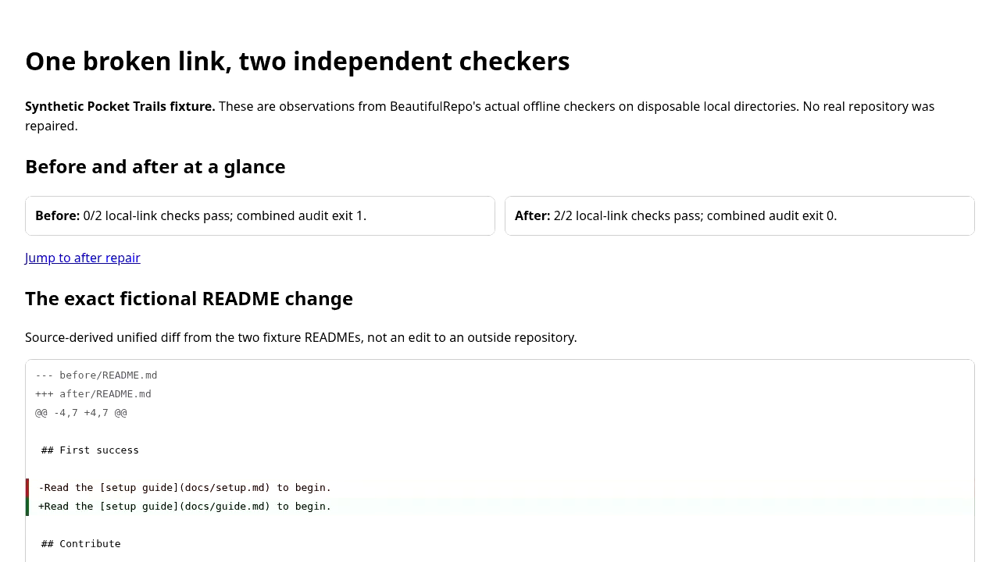
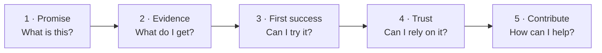

<div align="center">
  <h1>✨ BeautifulRepo</h1>
  <p><strong>Catch concrete README and local-documentation problems before a new contributor does.</strong></p>
  <p>Dependency-free offline checks, reproducible examples and practical templates for repositories worth exploring.</p>
</div>

<p align="center">
  <a href="https://github.com/drevendev/BeautifulRepo/actions/workflows/quality.yml"></a>
  <a href="LICENSE"></a>
  <a href="tools/README.md"></a>
  <a href="tools/README.md"></a>
</p>

<p align="center">
  <a href="SHOWCASE.md">See the before/after</a> ·
  <a href="#working-proof">Run an audit</a> ·
  <a href="guides/adopting-the-checks.md#add-it-to-a-workflow">Run checks on PRs</a> ·
  <a href="#start-here">Start here</a> ·
  <a href="examples/README.md">Working examples</a> ·
  <a href="CONTRIBUTING.md">Contribute</a>
</p>

---

> [!TIP]
> **Beautiful is not “more decoration.”** A strong repository reduces the time from landing on the page to understanding the result, trying it, trusting it, and knowing how to contribute.

## Working proof

**See the result first:** the [text-first Pocket Trails showcase](SHOWCASE.md)
shows the source-derived fix, exact checker exits and a reproducible
command before you run anything on your own checkout.
The same synthetic result now has a [permanent public browser recording, still
and descriptive captions](showcase/pocket-trails/README.md); these are actual
Chromium-captured pixels, not a real-user or external-repository experiment.

[](SHOWCASE.md)
 The example is
synthetic; the [PatchPitch case study](case-studies/patchpitch.md) uses real
repository revisions and clearly states what the audit missed.

**Catch concrete README and local-documentation problems before a new contributor does.**
BeautifulRepo's main product is a set of **read-only, offline documentation
checks**, backed by a practical handbook. They report specific observations,
not a beauty score. You need **Python 3.11+** and Git; no third-party Python
packages are installed.

**Audit your own checkout first.** From a directory containing your
repository as `your-repository/` (replace that name with its real folder name),
clone BeautifulRepo **beside** it and run:

```bash
git clone https://github.com/drevendev/BeautifulRepo.git
cd BeautifulRepo
python -I tools/audit_bundle.py ../your-repository --fail-on never
```

The command inspects **your repository**, not the BeautifulRepo checkout.
It runs all three real checks: repository entry points, local Markdown links
and local HTML/fragment navigation. It reports findings and source locations
without running target code or fetching external URLs. `--fail-on never`
makes **entry-point findings advisory**, but broken local links still produce
exit **1**; exit **0** means no threshold-reaching findings (warnings can
remain), and exit **2** means incomplete evidence. For a stricter entry-point
threshold, use `--fail-on warning`. To audit BeautifulRepo itself instead,
run `python -I tools/audit_bundle.py .` from this directory.
A clean result cannot certify a good README. See the
[combined audit guide](guides/combined-audit.md) and
[rule reference](guides/audit-rule-reference.md) for exact scope and limits.

**Want these checks on every pull request?** [Copy the SHA-pinned v0.2.0
GitHub Actions workflow](guides/adopting-the-checks.md#add-it-to-a-workflow).
It runs the released repository, Markdown-link and HTML-navigation checks in
CI, without copying BeautifulRepo tools into your repository. The newer
combined CLI (`audit_bundle.py`) and `audit-profile` Action input are
**not included in that pin**. Its checks do not execute your project code,
fetch external links or certify rendered accessibility.

**Reproduce a visible before/after:** this bundled demonstration uses two
**fictional** README versions in a disposable temporary directory:

```bash
python examples/repository-audit/demo.py --format text
```

This text view shows each rule, its source location and what remains after
editing the disposable fictional README. Omit `--format text` for the
machine-readable JSON demonstration. The summary, checked by the example's
regression tests, is:

```text
before: 0 errors, 4 warnings, 1 informational finding
after:  0 errors, 1 warning,  1 informational finding
```

The fixes remove a placeholder, a skipped heading level and an empty-header
layout table. The missing-license warning and optional contribution-guide
information remain: a lower count is **not** a correctness certificate.
[Inspect the fixture and findings](examples/repository-audit/README.md).

**See the missing-link check too.** The [three-checker synthetic demo](examples/combined-audit/README.md)
uses the *actual combined audit* on disposable before/after checkouts:

```bash
python -I examples/combined-audit/demo.py
python -I examples/combined-audit/demo.py --format html > pocket-trails-audit.html
```

Before the fix, both local link checkers report `docs/setup.md` missing;
after changing the fictional README link to an existing guide, both clear.
The demo verifies those observations and leaves its fixtures byte-identical
after each audit.
The optional HTML file shows the **actual synthetic** before/after diagnostics
and a source-derived unified diff of the one-line README repair; open it locally
in a browser.
It is not a screenshot, real-repository repair or evidence of user adoption.

For an **actual browser-rendered screenshot of that synthetic report**, with
Chromium/Chrome installed locally (optional), run:

```bash
python -I examples/combined-audit/capture.py --output-dir ../beautifulrepo-audit-capture
```

This saves the generated `report.html` and requested desktop/mobile
PNG captures without touching the audited fixtures. The
[capture walkthrough](examples/combined-audit/README.md#capture-actual-browser-screenshots-optional)
explains exact limits: these are synthetic screenshots, not mobile-device,
accessibility or real-user evidence. Neither the audit nor its tests require
Chromium. The optional Chrome workflow also creates a checksummed
[text companion](examples/combined-audit/README.md#reproduce-screenshots-in-github-actions-synthetic-only)
for those synthetic screenshots; its description is not pixel verification.

**Recorded result on a real repository (not the fictional demo):**
On 2026-10-23, the v0.2.0 audit pinned to
[`4f06f26`](https://github.com/drevendev/BeautifulRepo/commit/4f06f26ccef6e8b28d77c71633482b7a1a68518a)
was run against two fixed revisions of
[PatchPitch](case-studies/patchpitch.md):

- [Before `1424fc8`](https://github.com/drevendev/PatchPitch/tree/1424fc8fbfef82a5cd473272843e0c5cdc097b36):
  **0 errors, 0 warnings, 1 informational finding** (`contributing.missing`).
- [After `43284a7`](https://github.com/drevendev/PatchPitch/tree/43284a7286ead07d37ff32b8206ac4000856fd04):
  **0 errors, 0 warnings, 0 informational findings**.

These are the recorded audit summaries from the
[revision-pinned case study](case-studies/patchpitch.md), **not a fresh run**
or a measure of reader satisfaction. The audit noticed the new contribution
document; it did **not** detect the more consequential README first-run
improvement, which was separately verified without a local AI model.
The case also records unresolved text-contrast concerns. A clean audit
cannot certify a good first-run experience.

### A separate runnable CLI starter

The tested [Rowcount starter](examples/cli-starter/README.md) shows how a
small repository can present a first success. From the repository root:

```bash
python examples/cli-starter/rowcount.py examples/cli-starter/sample.csv
```

Expected stdout, checked by the example's unit tests:

```text
Data rows: 3
```

The [input CSV](examples/cli-starter/sample.csv) and
[Python implementation](examples/cli-starter/rowcount.py) are available to
inspect. This is deliberately a small count of data records, not a schema
validator or a hosted service. No package installation or network access
is required. CI runs the examples and checks on Ubuntu (Python 3.11 and
3.14) and Windows (Python 3.14); macOS is not tested.

For a real application of this approach to BeautifulRepo itself, see the
[README before/after case](case-studies/readme-first-success-case.md): fixed
revisions, a clean-clone run, horizontal reflow observations at three emulated
widths, and contrast measured only for light at 1280 px and dark at 375 px.
Keyboard navigation, real 400% zoom and screen readers remain untested.

For real repository revisions, the [offline audit comparison](guides/audit-before-after.md)
reads two saved entry-point audit reports and lists changed rule counts and
coverage without inventing a beauty score or claiming that warnings were fixed.

## Start here

| Your goal | First step | Visible result |
| --- | --- | --- |
| Diagnose an existing repository | Run the [offline audit](guides/repository-audit.md) and use the [repository checklist](checklists/repository.md) | Specific findings, not a beauty score |
| Start a new one | Adapt the [README scaffold](templates/README.template.md) with the [first-success checklist](checklists/first-success.md) | A reproducible command and an honest scope |
| Borrow a working example | Choose from [five starter types](examples/README.md) | Real source, tests and exact limitations |

## The visitor journey

A repository should answer the next question before the reader has to hunt for it.



**Text alternative:** Promise (what is this?) → Evidence (what do I get?) →
First success (can I try it?) → Trust (can I rely on it?) →
Contribute (how can I help?). Follow the stages in that order.

That sequence is the core BeautifulRepo test. Decoration is optional; a clear path is not.

## What you get

- **📋 Checklists** — prioritize clarity, onboarding, trust, accessibility and maintenance.
- **🧱 Patterns** — source-backed examples of what strong repositories do and why it works.
- **🧰 Templates** — reusable README, application, collection, research and security-policy scaffolds with explicit placeholders.
- **🔎 Tools** — small dependency-free checks that keep repository documentation honest.
- **🖼️ Visual guidance** — theme-aware media, useful alt text and evidence-first screenshots.
- **🧭 Community guidance** — contribution and reporting surfaces that do not invent unsupported promises.

## See the difference

The [PocketDiff before/after page](examples/readme-visuals/README.md) is an
**explicitly fictional** copy and visual-layout exercise. It contrasts vague
superlatives and decorative badges with a concrete (illustrative) CSV report,
a text alternative and a command transcript. **PocketDiff is not an installable
or tested CLI.**

The [design-intent brief](examples/readme-visuals/DESIGN_INTENT.md) explains
why the light/dark illustrations fit that imagined reader, what was rejected,
and how to replace them with evidence from a real product. For genuinely runnable results, use the [offline audit](#working-proof)
or the separate [Rowcount starter](examples/cli-starter/README.md).

## This repository checks itself

BeautifulRepo includes small offline checks instead of relying on “looks good to me.”

From a checkout with **Python 3.11+**:

```bash
python tools/catalog.py
python tools/docs_links.py
python tools/html_navigation.py
python -m unittest discover -s tests -v
python tools/repo_audit.py .
```

Each command exits with status 0 when the check passes. The tools print a line
starting with `OK:` (the audit prints a summary with `0 error(s)`), and the unit
tests end with `OK`. A failure prints `ERROR:` or a test name with the file to fix.

The same checks run in GitHub Actions. They validate structured catalog metadata, generated catalog drift, repository-owned relative Markdown destinations, and structural regressions in the examples and public repository surfaces.

CI also runs `python -I tools/workflow_badges.py --root . --repo drevendev/BeautifulRepo --require-badge` to catch a missing local workflow behind the root README's GitHub Actions status badge. This **does not** verify that CI ran or passed; it only checks the referenced workflow file.

The additional HTML navigation check verifies bounded local HTML links, media assets and section fragments.
The additional action-pin check detects workflow SHA/annotation drift against a locally
reviewed manifest; it does not verify upstream release signatures or CI success:

```bash
python -I tools/action_pins.py --root .
```

Other repositories can run the audit and both link checks as a GitHub Action
pinned to a reviewed commit. See [run the checks in your repository](guides/adopting-the-checks.md).
Coding agents can run the same audit through the BeautifulRepo plugin for
Claude Code and Codex. See [use BeautifulRepo from an agent](guides/agent-plugin.md).

The [experimental local MCP adapter](guides/local-mcp.md) is a **separate,
optional** stdio interface to the same offline checks. Its
[pinned checkout and host-specific trial recipes](guides/local-mcp.md#reproduce-an-immutable-development-checkout-posix)
are available for Claude Code and Codex, but a configuration command or SDK
smoke PASS does **not** establish a successful model-host installation.

These tools do **not** claim to be a live-link crawler, complete GitHub Markdown renderer, security scanner, runtime accessibility certification, or repository beauty score. Manual judgement still matters.

## Explore the handbook

Keep the three decisions above short. These are the detailed reference routes,
not a second copy of the first-screen chooser.

- **Explain and present:** [README design](guides/readme.md),
  [visual README patterns](guides/readme-visuals.md),
  [editorial evidence kit](guides/editorial-evidence.md),
  [AI-written README evidence review](guides/ai-readme-review.md),
  [repository discoverability](guides/discoverability.md).
- **Adapt an actual starter:** [CLI guide](guides/cli-repositories.md) and
  [example](examples/cli-starter/README.md);
  [library guide](guides/library-repositories.md) and
  [example](examples/library-starter/README.md);
  [application guide](guides/application-repositories.md) and
  [example](examples/application-starter/README.md);
  [research/data guide](guides/research-data-repositories.md) and
  [example](examples/research-data-starter/README.md);
  [curated-collection guide](guides/curated-collections.md) and
  [example](examples/curated-starter/README.md).
- **Maintain evidence and trust:** [release notes](guides/release-notes.md) with
  a [release-note template](templates/RELEASE_NOTES.template.md),
  [maintenance workflow](guides/maintenance-workflow.md),
  [evidence-led issue triage](guides/issue-triage.md),
  [first-contribution route](guides/first-contribution.md) and
  [copyable starter issue](templates/GOOD_FIRST_ISSUE.template.md),
  [offline repository audit](guides/repository-audit.md),
  [tools](tools/README.md) and how to
  [run them in your repository's CI](guides/adopting-the-checks.md) or
  [from Claude Code and Codex](guides/agent-plugin.md) under the
  [agent ground rules](guides/agent-safety.md),
  [confidentiality checklist for private repositories](checklists/confidentiality.md),
  [plan-aware private repository guide](guides/private-repositories.md),
  [internal/private README template](templates/INTERNAL_README.template.md) and
  [filled fictional internal example](examples/internal-repository/README.md),
  [Community safety readiness](guides/community-safety.md).
- **Research and adapt:** [case studies and their procedure](case-studies/README.md),
  [annotated studies](case-studies/first-patterns.md),
  [reviewed sources](catalog/README.md),
  [programs and community events](guides/programs.md),
  [README template](templates/README.template.md),
  [application template](templates/APPLICATION_README.template.md),
  [library template](templates/LIBRARY_README.template.md),
  [research/data template](templates/RESEARCH_DATA_README.template.md),
  [curated README template](templates/CURATED_README.template.md),
  and the [roadmap](ROADMAP.md).

## Principles

**Clarity before decoration.** Explain the result before the implementation.  
**Evidence before badges.** A badge must represent a real, relevant fact.  
**Patterns before imitation.** Reuse ideas; verify permissions before copying material.  
**Useful before exhaustive.** Every resource needs a reason to exist and a next action.  
**Accessible by default.** Keep essential information readable without images, animation or color.

## Status and contribution

BeautifulRepo is a working handbook, not an exhaustive or independently certified standard.
The [roadmap](ROADMAP.md) distinguishes published guidance from remaining work on
real-agent evaluations, additional before/after cases and manually verified visual
accessibility. Private-repository guidance and the repository self-check are already
published; passing static CI is not evidence of a live model or accessibility test.

Suggestions and small improvements are welcome. Start with [CONTRIBUTING.md](CONTRIBUTING.md). Ask questions in [Discussions](https://github.com/drevendev/BeautifulRepo/discussions). Please report accessibility barriers through [GitHub Issues](https://github.com/drevendev/BeautifulRepo/issues/new/choose), and follow the [community safety guidance](guides/community-safety.md) before posting sensitive material.

Public documentation is maintained in English.

For a practical continuity example, see the [maintainer handoff recipe](guides/maintainer-handoff.md):
it separates public onboarding from permissions, releases, and private reporting.
When maintenance really ends, the [pause/archive recipe](guides/repository-retirement.md)
and [status notice template](templates/REPOSITORY_STATUS_NOTICE.template.md)
show how to leave honest last-known instructions before GitHub becomes read-only.

## License

[MIT](LICENSE). Linked projects and their assets retain their own licenses and trademarks.
Listing a source does not endorse every claim it makes or relicense its contents.
