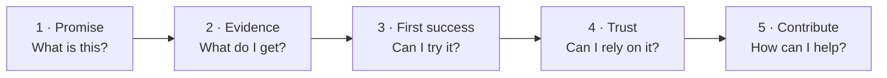

<div align="center">
  <h1>✨ BeautifulRepo</h1>
  <p><strong>Make your repository easy to understand, pleasant to explore, and worth contributing to.</strong></p>
  <p>Practical patterns, templates, examples, and tiny offline tools for maintainers who want the repository itself to feel finished.</p>
</div>

<p align="center">
  <a href="https://github.com/drevendev/BeautifulRepo/actions/workflows/quality.yml"></a>
  <a href="LICENSE"></a>
  <a href="tools/README.md"></a>
  <a href="tools/README.md"></a>
</p>

<p align="center">
  <a href="#working-proof">Working proof</a> ·
  <a href="#start-here">Start here</a> ·
  <a href="examples/README.md">Working examples</a> ·
  <a href="CONTRIBUTING.md">Contribute</a>
</p>

---

> [!TIP]
> **Beautiful is not “more decoration.”** A strong repository reduces the time from landing on the page to understanding the result, trying it, trusting it, and knowing how to contribute.

## Working proof

**A real checkout command, not a concept image.** The tested
[Rowcount starter](examples/cli-starter/README.md) reads a bundled CSV fixture
locally. You need **Python 3.11+** and Git. Get a checkout:

```bash
git clone https://github.com/drevendev/BeautifulRepo.git
cd BeautifulRepo
```

Then, from the repository root:

```bash
python examples/cli-starter/rowcount.py examples/cli-starter/sample.csv
```

Expected stdout, checked by the example's unit tests:

```text
Data rows: 3
```

The [input CSV](examples/cli-starter/sample.csv) and
[Python implementation](examples/cli-starter/rowcount.py) are available to inspect.
This is a deliberately small count of data records, not a schema validator or a
hosted service. No package installation or network access is required.
CI runs the examples and checks on Ubuntu (Python 3.11 and 3.14) and Windows
(Python 3.14); macOS is not tested.

For a real application of this approach to BeautifulRepo itself, see the
[README before/after case](case-studies/readme-first-success-case.md): fixed
revisions, a clean-clone run, GitHub's rendering checked at three widths in both
themes, and what was not checked.

For an actual **before/after documentation diagnostic**, run
`python examples/repository-audit/demo.py` from the same root. Its
[test-backed walkthrough](examples/repository-audit/README.md) shows four
warnings becoming one after README fixes; the fictional input is disclosed,
and unresolved license/contribution observations remain visible.

## Start here

| Your goal | First step | Visible result |
| --- | --- | --- |
| Diagnose an existing repository | Run the [offline audit](guides/repository-audit.md) and use the [repository checklist](checklists/repository.md) | Specific findings, not a beauty score |
| Start a new one | Adapt the [README scaffold](templates/README.template.md) with the [first-success checklist](checklists/first-success.md) | A reproducible command and an honest scope |
| Borrow a working example | Choose from [five starter types](examples/README.md) | Real source, tests and exact limitations |

## The visitor journey

A repository should answer the next question before the reader has to hunt for it.



**Text alternative:** Promise (what is this?) → Evidence (what do I get?) →
First success (can I try it?) → Trust (can I rely on it?) →
Contribute (how can I help?). Follow the stages in that order.

That sequence is the core BeautifulRepo test. Decoration is optional; a clear path is not.

## What you get

- **📋 Checklists** — prioritize clarity, onboarding, trust, accessibility and maintenance.
- **🧱 Patterns** — source-backed examples of what strong repositories do and why it works.
- **🧰 Templates** — reusable README, application, collection, research and security-policy scaffolds with explicit placeholders.
- **🔎 Tools** — small dependency-free checks that keep repository documentation honest.
- **🖼️ Visual guidance** — theme-aware media, useful alt text and evidence-first screenshots.
- **🧭 Community guidance** — contribution and reporting surfaces that do not invent unsupported promises.

## See the difference

The [PocketDiff before/after page](examples/readme-visuals/README.md) is an
**explicitly fictional** copy and visual-layout exercise. It contrasts vague
superlatives and decorative badges with a concrete (illustrative) CSV report,
a text alternative and a command transcript. **PocketDiff is not an installable
or tested CLI.**

The [design-intent brief](examples/readme-visuals/DESIGN_INTENT.md) explains
why the light/dark illustrations fit that imagined reader, what was rejected,
and how to replace them with evidence from a real product. For a genuinely
runnable result, use the Rowcount command in
[Working proof](#working-proof) instead.

## This repository checks itself

BeautifulRepo includes small offline checks instead of relying on “looks good to me.”

From a checkout with **Python 3.11+**:

```bash
python tools/catalog.py
python tools/docs_links.py
python tools/html_navigation.py
python -m unittest discover -s tests -v
python tools/repo_audit.py .
```

Each command exits with status 0 when the check passes. The tools print a line
starting with `OK:` (the audit prints a summary with `0 error(s)`), and the unit
tests end with `OK`. A failure prints `ERROR:` or a test name with the file to fix.

The same checks run in GitHub Actions. They validate structured catalog metadata, generated catalog drift, repository-owned relative Markdown destinations, and structural regressions in the examples and public repository surfaces.

CI also runs `python -I tools/workflow_badges.py --root . --repo drevendev/BeautifulRepo` to catch a missing local workflow behind the root README's GitHub Actions status badge. This **does not** verify that CI ran or passed; it only checks the referenced workflow file.

The additional HTML navigation check verifies bounded local HTML links, media assets and section fragments.

Other repositories can run the audit and both link checks as a GitHub Action
pinned to a reviewed commit. See [run the checks in your repository](guides/adopting-the-checks.md).
Coding agents can run the same audit through the BeautifulRepo plugin for
Claude Code and Codex. See [use BeautifulRepo from an agent](guides/agent-plugin.md).

These tools do **not** claim to be a live-link crawler, complete GitHub Markdown renderer, security scanner, runtime accessibility certification, or repository beauty score. Manual judgement still matters.

## Explore the handbook

Keep the three decisions above short. These are the detailed reference routes,
not a second copy of the first-screen chooser.

- **Explain and present:** [README design](guides/readme.md),
  [visual README patterns](guides/readme-visuals.md),
  [editorial evidence kit](guides/editorial-evidence.md),
  [AI-written README evidence review](guides/ai-readme-review.md),
  [repository discoverability](guides/discoverability.md).
- **Adapt an actual starter:** [CLI guide](guides/cli-repositories.md) and
  [example](examples/cli-starter/README.md);
  [library guide](guides/library-repositories.md) and
  [example](examples/library-starter/README.md);
  [application guide](guides/application-repositories.md) and
  [example](examples/application-starter/README.md);
  [research/data guide](guides/research-data-repositories.md) and
  [example](examples/research-data-starter/README.md);
  [curated-collection guide](guides/curated-collections.md) and
  [example](examples/curated-starter/README.md).
- **Maintain evidence and trust:** [release notes](guides/release-notes.md) with
  a [release-note template](templates/RELEASE_NOTES.template.md),
  [maintenance workflow](guides/maintenance-workflow.md),
  [offline repository audit](guides/repository-audit.md),
  [tools](tools/README.md) and how to
  [run them in your repository's CI](guides/adopting-the-checks.md) or
  [from Claude Code and Codex](guides/agent-plugin.md) under the
  [agent ground rules](guides/agent-safety.md),
  [confidentiality checklist for private repositories](checklists/confidentiality.md),
  [plan-aware private repository guide](guides/private-repositories.md),
  [internal/private README template](templates/INTERNAL_README.template.md) and
  [filled fictional internal example](examples/internal-repository/README.md),
  [Community safety readiness](guides/community-safety.md).
- **Research and adapt:** [case studies and their procedure](case-studies/README.md),
  [annotated studies](case-studies/first-patterns.md),
  [reviewed sources](catalog/README.md),
  [programs and community events](guides/programs.md),
  [README template](templates/README.template.md),
  [application template](templates/APPLICATION_README.template.md),
  [library template](templates/LIBRARY_README.template.md),
  [research/data template](templates/RESEARCH_DATA_README.template.md),
  [curated README template](templates/CURATED_README.template.md),
  and the [roadmap](ROADMAP.md).

## Principles

**Clarity before decoration.** Explain the result before the implementation.  
**Evidence before badges.** A badge must represent a real, relevant fact.  
**Patterns before imitation.** Reuse ideas; verify permissions before copying material.  
**Useful before exhaustive.** Every resource needs a reason to exist and a next action.  
**Accessible by default.** Keep essential information readable without images, animation or color.

## Status and contribution

BeautifulRepo is a working handbook, not an exhaustive or independently certified standard.
The [roadmap](ROADMAP.md) lists what is available and the open workstreams: agent skills, real before/after cases and private repositories.

Suggestions and small improvements are welcome. Start with [CONTRIBUTING.md](CONTRIBUTING.md). Ask questions in [Discussions](https://github.com/drevendev/BeautifulRepo/discussions). Please report accessibility barriers through [GitHub Issues](https://github.com/drevendev/BeautifulRepo/issues/new/choose), and follow the [community safety guidance](guides/community-safety.md) before posting sensitive material.

Public documentation is maintained in English.

For a practical continuity example, see the [maintainer handoff recipe](guides/maintainer-handoff.md):
it separates public onboarding from permissions, releases, and private reporting.

## License

[MIT](LICENSE). Linked projects and their assets retain their own licenses and trademarks.
Listing a source does not endorse every claim it makes or relicense its contents.
