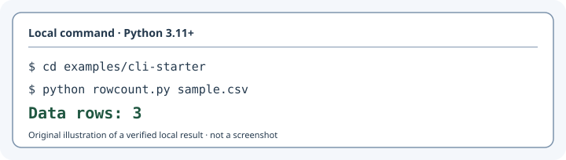

# Rowcount — see a verified result first

**One local CSV, three data rows.** This illustrative transcript shows the
real output of the checked-in Rowcount example, not a screenshot or a release.

<picture>
  <source media="(prefers-color-scheme: dark)" srcset="rowcount-dark.svg">
  <source media="(prefers-color-scheme: light)" srcset="rowcount-light.svg">
  
</picture>

The same result without the image: run `python rowcount.py sample.csv` inside
`examples/cli-starter`; stdout is **`Data rows: 3`**.

## Reproduce from a fresh checkout

Python 3.11+; from the BeautifulRepo root:

```bash
python examples/cli-starter/rowcount.py examples/cli-starter/sample.csv
```

Expected and locally reproduced stdout:

```text
Data rows: 3
```

[The input](../../cli-starter/sample.csv) has one header record and three
data records. The [actual CLI](../../cli-starter/rowcount.py) is standard-library
only; it excludes fully blank records and reports malformed column counts, but
is **not** a general CSV validator, distributed package or network service.

[See the quieter editorial treatment](editorial.md) ·
[Read the scope and design decisions](README.md).

_Illustrated evidence is not a rendered GitHub or accessibility certification._
