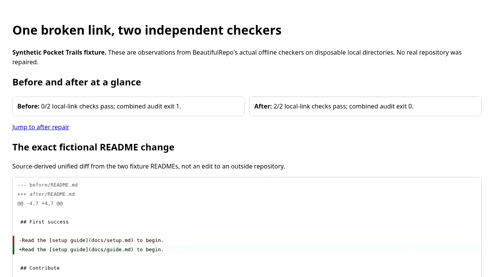

# Working proof: source evidence, commands and limits

This companion keeps the reproducible diagnostics, capture instructions and
recorded results behind the [short README first run](../README.md#working-proof).
The examples below are **not** independent user testing or a beauty score.

**See the result first:** the [text-first Pocket Trails showcase](../SHOWCASE.md)
shows the source-derived fix, exact checker exits and a reproducible
command before you run anything on your own checkout.
The same synthetic result now has a [permanent public browser recording, still
and descriptive captions](../showcase/pocket-trails/README.md); these are actual
Chromium-captured pixels, not a real-user or external-repository experiment.

[](../SHOWCASE.md)
 The example is
synthetic; the [PatchPitch case study](../case-studies/patchpitch.md) uses real
repository revisions and clearly states what the audit missed.

**Catch concrete README and local-documentation problems before a new contributor does.**
BeautifulRepo's main product is a set of **read-only, offline documentation
checks**, backed by a practical handbook. They report specific observations,
not a beauty score. You need **Python 3.11+** and Git; no third-party Python
packages are installed.

**Audit your own checkout first.** From a directory containing your
repository as `your-repository/` (replace that name with its real folder name),
clone BeautifulRepo **beside** it. Paste the entire Bash block at once; a
failed setup command, SHA mismatch or Python version check prevents the audit
from running:

```bash
git clone https://github.com/drevendev/BeautifulRepo.git &&
cd BeautifulRepo &&
git checkout --detach e494a0d5be90dd718db4a25e777aba8abc295ecf &&
actual=$(git rev-parse HEAD) &&
test "$actual" = "e494a0d5be90dd718db4a25e777aba8abc295ecf" &&
python -I -c 'import sys; sys.exit("Python 3.11+ required") if sys.version_info < (3, 11) else print(sys.version.split()[0])' &&
python -I tools/audit_bundle.py ../your-repository --fail-on never
```

The detached commit pins a reviewed **development checkout** containing the
combined audit; it is not a new release or the older `v0.2.0` Action pin.
Its [six Quality CI jobs](https://github.com/drevendev/BeautifulRepo/actions/runs/45364559651)
passed on the exact SHA, including hard-link and redirected-path source
guards and legacy-console Unicode diagnostics. No independent first-time
installation or user experience is inferred.
Cloning needs network access; the audit itself does not. To adopt a newer
revision, review and intentionally change the pin rather than silently
running whatever is on `master`.

For Windows, see the [PowerShell first-run commands](../guides/combined-audit.md#windows-powershell-first-run), including how to inspect the native exit code.

The command inspects **your repository**, not the BeautifulRepo checkout.
It runs all three real checks: repository entry points, local Markdown links
and local HTML/fragment navigation. It reports findings and source locations
without running target code or fetching external URLs. `--fail-on never`
makes **entry-point findings advisory**, but broken local links still produce
exit **1**; exit **0** means no threshold-reaching findings (warnings can
remain), and exit **2** means an invalid root or incomplete evidence.
For a stricter entry-point threshold, use `--fail-on warning`. To audit BeautifulRepo itself instead,
run `python -I tools/audit_bundle.py .` from this directory.
A clean result cannot certify a good README. See the
[combined audit guide](../guides/combined-audit.md) and
[rule reference](../guides/audit-rule-reference.md) for exact scope and limits.

**Want these checks on every pull request?** [Copy the SHA-pinned v0.2.0
GitHub Actions workflow](../guides/adopting-the-checks.md#add-it-to-a-workflow).
It runs the released repository, Markdown-link and HTML-navigation checks in
CI, without copying BeautifulRepo tools into your repository. The newer
combined CLI (`audit_bundle.py`) and `audit-profile` Action input are
**not included in that pin**. Its checks do not execute your project code,
fetch external links or certify rendered accessibility.

**Reproduce a visible before/after:** this bundled demonstration uses two
**fictional** README versions in a disposable temporary directory:

```bash
python examples/repository-audit/demo.py --format text
```

This text view shows each rule, its source location and what remains after
editing the disposable fictional README. Omit `--format text` for the
machine-readable JSON demonstration. The summary, checked by the example's
regression tests, is:

```text
before: 0 errors, 4 warnings, 1 informational finding
after:  0 errors, 1 warning,  1 informational finding
```

The fixes remove a placeholder, a skipped heading level and an empty-header
layout table. The missing-license warning and optional contribution-guide
information remain: a lower count is **not** a correctness certificate.
[Inspect the fixture and findings](../examples/repository-audit/README.md).

**See the missing-link check too.** The [three-checker synthetic demo](../examples/combined-audit/README.md)
uses the *actual combined audit* on disposable before/after checkouts:

```bash
python -I examples/combined-audit/demo.py
python -I examples/combined-audit/demo.py --format html > pocket-trails-audit.html
```

Before the fix, both local link checkers report `docs/setup.md` missing;
after changing the fictional README link to an existing guide, both clear.
The demo verifies those observations and leaves its fixtures byte-identical
after each audit.
The optional HTML file shows the **actual synthetic** before/after diagnostics
and a source-derived unified diff of the one-line README repair; open it locally
in a browser.
It is not a screenshot, real-repository repair or evidence of user adoption.

For an **actual browser-rendered screenshot of that synthetic report**, with
Chromium/Chrome installed locally (optional), run:

```bash
python -I examples/combined-audit/capture.py --output-dir ../beautifulrepo-audit-capture
```

This saves the generated `report.html` and requested desktop/mobile
PNG captures without touching the audited fixtures. The
[capture walkthrough](../examples/combined-audit/README.md#capture-actual-browser-screenshots-optional)
explains exact limits: these are synthetic screenshots, not mobile-device,
accessibility or real-user evidence. Neither the audit nor its tests require
Chromium. The optional Chrome workflow also creates a checksummed
[text companion](../examples/combined-audit/README.md#reproduce-screenshots-in-github-actions-synthetic-only)
for those synthetic screenshots; its description is not pixel verification.

**Recorded result on a real repository (not the fictional demo):**
On 2026-10-23, the v0.2.0 audit pinned to
[`4f06f26`](https://github.com/drevendev/BeautifulRepo/commit/4f06f26ccef6e8b28d77c71633482b7a1a68518a)
was run against two fixed revisions of
[PatchPitch](../case-studies/patchpitch.md):

- [Before `1424fc8`](https://github.com/drevendev/PatchPitch/tree/1424fc8fbfef82a5cd473272843e0c5cdc097b36):
  **0 errors, 0 warnings, 1 informational finding** (`contributing.missing`).
- [After `43284a7`](https://github.com/drevendev/PatchPitch/tree/43284a7286ead07d37ff32b8206ac4000856fd04):
  **0 errors, 0 warnings, 0 informational findings**.

These are the recorded audit summaries from the
[revision-pinned case study](../case-studies/patchpitch.md), **not a fresh run**
or a measure of reader satisfaction. The audit noticed the new contribution
document; it did **not** detect the more consequential README first-run
improvement, which was separately verified without a local AI model.
The case also records unresolved text-contrast concerns. A clean audit
cannot certify a good first-run experience.

## A separate runnable CLI starter

The tested [Rowcount starter](../examples/cli-starter/README.md) shows how a
small repository can present a first success. From the repository root:

```bash
python examples/cli-starter/rowcount.py examples/cli-starter/sample.csv
```

Expected stdout, checked by the example's unit tests:

```text
Data rows: 3
```

The [input CSV](../examples/cli-starter/sample.csv) and
[Python implementation](../examples/cli-starter/rowcount.py) are available to
inspect. This is deliberately a small count of data records, not a schema
validator or a hosted service. No package installation or network access
is required. CI runs the examples and checks on Ubuntu (Python 3.11 and
3.14) and Windows (Python 3.14); macOS is not tested.

For a real application of this approach to BeautifulRepo itself, see the
[README before/after case](../case-studies/readme-first-success-case.md): fixed
revisions, a clean-clone run, horizontal reflow observations at three emulated
widths, and contrast measured only for light at 1280 px and dark at 375 px.
Keyboard navigation, real 400% zoom and screen readers remain untested.

For real repository revisions, the [offline audit comparison](../guides/audit-before-after.md)
reads two saved entry-point audit reports and lists changed rule counts and
coverage without inventing a beauty score or claiming that warnings were fixed.
