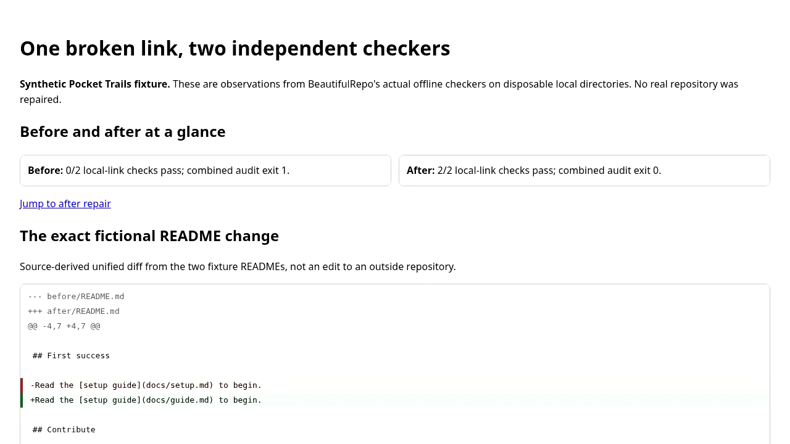

# Pocket Trails — real Chromium capture of a fictional audit

**Watch the recorded browser demonstration:** [MP4, H.264 (545 KiB)](pocket-trails.mp4) · [WebM, VP9 (1.1 MiB)](pocket-trails.webm) · [descriptive WebVTT](pocket-trails.vtt) · [local offline playback page](pocket-trails-player.html).

This is a **23.52-second, 1280×720, silent Chromium screen recording of a synthetic Pocket Trails HTML report**. The report is produced by BeautifulRepo's real local link checkers on disposable fictional fixtures. It is **not** a real person's session, an external repository repair, a screen-reader test, a recording of live CLI execution, or proof of the current `master` audit run.

## What the video shows (complete text alternative)

1. **0:00–0:03** — Fictional Pocket Trails: before repair, neither of two local-link checks passes; after repair, both pass.
2. **0:03–0:11** — The README's broken `docs/setup.md` link changes to existing `docs/guide.md`.
3. **0:11–0:14** — Before: broken local links. After: both local-link checks succeed.
4. **0:14–0:19** — The page scrolls back to the before/after overview.
5. **0:19–0:23.52** — Closing reminder: the example is synthetic and no external repository was repaired.

The [WebVTT track](pocket-trails.vtt) contains authored visual descriptions, **not transcribed speech**. The [still image](pocket-trails-still.png) is an extracted video frame at 00:01, not a fabricated illustration.

## Inspect and reproduce

[SHOWCASE.md](../../SHOWCASE.md) documents the exact fictional README diff and both checker exit codes. The [combined-audit example](../../examples/combined-audit/README.md) provides the commands, fixtures, source and automated regression tests. The browser capture comes from an **earlier recording associated with PR #279**; it was not freshly generated from the public commit containing these assets. The underlying fixture observations are reproducible, but that does not make the saved pixels current-head evidence.

For a local captioned preview, download **all five media files** into the same folder, then open `pocket-trails-player.html` in a browser. If local-file playback is restricted, serve that folder over a loopback-only HTTP server. GitHub's file viewer is not itself the validated HTML video player. The player embeds the five descriptive cues and includes the full text alternative; the standalone VTT is also available for compatible external players.

Both videos were fully decoded with FFmpeg 7.1.5; Chromium was tested in memory with the actual MP4 and descriptive cues at 1280 and 390 px. **Direct relative-path playback from these final public URLs, full keyboard behavior and screen-reader announcements have not been independently verified.** Media does not require dependencies for running the normal BeautifulRepo audit.

## Media integrity (SHA-256, source files)

- MP4: `af64b7c8e8c96b455ce69167c3f100f3fdce971c70f4387b9abe62de25cdba93`
- WebM: `08bf87594dfb411b69736ba50a0b82510ce9ad66cf38c8853a0622094b5937d9`
- PNG: `46d6e0febc501ca5349decab9ae690360b3a299afd6ca4e63c2f2728a7578299`
- VTT: `ef02e699893bf766c29ec93e7c08f427ea01d1b13587f97caa3914d46c80bc1d`
- HTML player: `9c204e253f0585c8f2e8ea8ee3bde5f99bad6d242b0fd56b5354be2de3a36f6d`

These hashes identify the published source media, not a guarantee of accessibility or end-user success.
